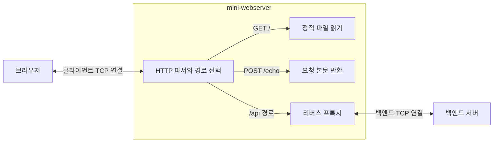
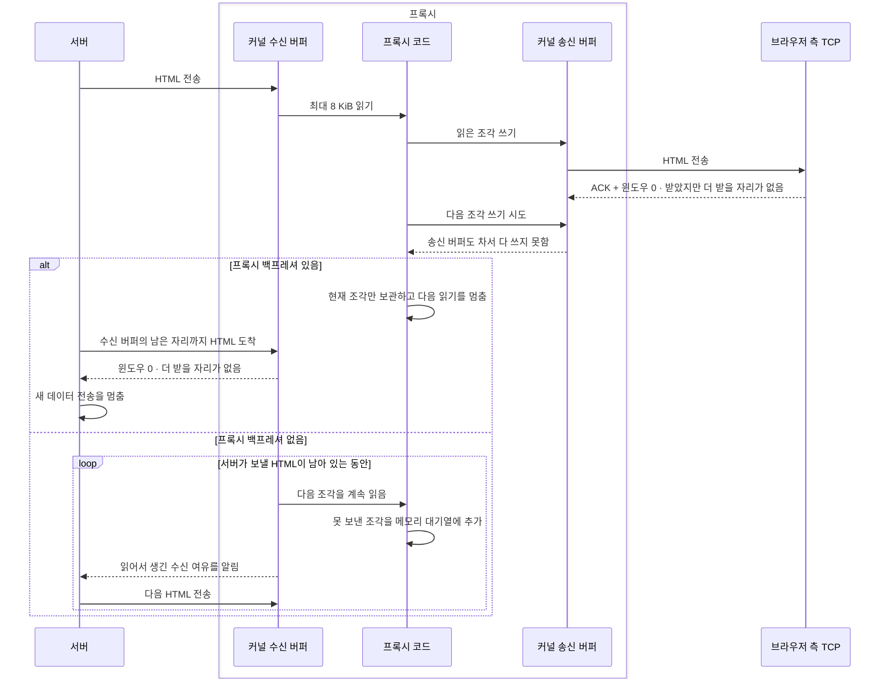

# mini-webserver

## 개요

C11과 POSIX 소켓으로 구현한 HTTP 웹 서버이자 리버스 프록시입니다. 정적 파일과 `POST /echo`는 직접 응답하고, 지정한 경로의 요청은 백엔드에 별도 TCP 연결을 열어 중계합니다. HTTP 요청 파싱과 응답 생성, 여러 연결의 동시 처리를 외부 HTTP 라이브러리 없이 구현했습니다.

## 서버 구조

브라우저는 하나의 주소에 접속합니다. 서버는 요청 헤더를 읽은 뒤 **어디에서 응답을 만들지** 결정합니다. 아래는 정적 파일 루트가 `./public`이고 `/api`를 백엔드로 보내도록 설정한 경우입니다.



### 요청 한 건의 처리 흐름

서버는 `socket() → bind() → listen()`으로 리스닝 소켓을 만들고, `accept()`가 반환한 연결 소켓을 논블로킹으로 설정합니다. TCP에서는 헤더 한 줄도 여러 번의 `recv()`로 나뉠 수 있습니다. 그래서 파서는 빈 줄(`\r\n\r\n`)까지 누적한 뒤 메서드·경로·헤더를 해석하고, 본문 길이는 `Content-Length`로 정합니다. [소켓 설정](src/net.c) · [HTTP 파서](src/http.c)

- **로컬 응답.** `GET /`이면 정적 파일 루트에서 `index.html`을 열어 상태 줄, 파일의 MIME 타입과 길이, 파일 내용을 보냅니다. 내장 경로인 `POST /echo`는 본문이 모두 도착하면 받은 바이트를 그대로 응답합니다. [파일 열기와 MIME 매핑](src/handlers.c) · [로컬 요청 처리](src/connection.c)
- **프록시 응답.** `GET /api/items?id=7`이면 경로 요소 단위로 가장 길게 일치하는 규칙을 선택합니다. 백엔드에 전달할 때는 프록시가 TCP 클라이언트가 되어 새 연결을 열고, 경로와 쿼리를 유지한 채 `Host`를 백엔드 주소로 바꿉니다. 백엔드의 상태 코드와 본문은 원래 브라우저 소켓으로 돌려주고, 응답을 마치면 연결을 닫습니다. [라우팅과 헤더 변환](src/handlers.c) · [응답 중계](src/connection.c)

### 여러 연결을 처리하는 방식

연결마다 `Connection`에 **다음에 읽거나 쓸 소켓, 현재 처리 단계, 아직 보내지 못한 바이트 수**를 보관합니다. 예를 들어 `POST /echo`의 5바이트 본문 중 `he`만 도착하면, 그 연결은 2바이트를 받은 상태에서 다음 읽기를 기다립니다. 응답을 마치거나 연결이 끊기면 해당 연결이 열어 둔 파일과 백엔드 소켓을 닫고 요청 버퍼를 해제합니다. [연결 상태와 자원 회수](src/connection.c)

같은 HTTP 처리 코드를 두고 연결을 맡는 방식을 선택할 수 있습니다. 기본 모델은 `pthread` **스레드 풀**입니다. 메인 스레드가 수락한 소켓을 대기 큐에 넣으면 미리 띄운 워커 4개가 하나씩 꺼내 응답을 마칠 때까지 담당합니다. 큐를 변경하는 동안만 뮤텍스를 잡고, 소켓 I/O는 잠금을 푼 뒤 수행합니다. `-m fork`에서는 자식 프로세스 하나가 연결 하나를 맡습니다. 이벤트 루프에서는 한 스레드가 여러 소켓을 감시하다가 준비된 연결의 다음 단계만 실행합니다. [스레드 풀과 프로세스 모델](src/main.c) · [이벤트 루프](src/event_loop.c)

## 설계 목표

웹 서버는 클라이언트의 요청에 직접 응답할 수 있습니다. 그렇다면 웹 서버 앞에 리버스 프록시를 두었을 때 어떤 부하를 줄일 수 있을까요?

우리 팀은 **리버스 프록시를 통해 다양한 상황에서 서버가 감당하는 부하를 줄이는 것**을 핵심 목표로 삼았습니다. 요청을 받아 응답을 돌려주기까지 세 가지 상황에 집중했습니다.

| 상황 | 설계 목표 |
|---|---|
| 같은 리소스를 반복해서 요청하거나 한 IP에서 요청이 몰릴 때 | 프록시에서 응답하거나 요청을 제한해 백엔드가 직접 처리하는 건수를 줄입니다. |
| 여러 백엔드로 요청을 분산하다가 서버 수가 바뀔 때 | 각 서버가 트래픽을 나눠 처리하면서, 구성 변경으로 다른 서버에 재배정되는 클라이언트 IP를 최소화합니다. |
| 클라이언트와 백엔드의 전송 속도가 다를 때 | 수신 측이 받아들일 수 있는 만큼 중계해, 프록시 메모리에 쌓이는 미전송 본문의 양을 제한합니다. |

## 리버스 프록시의 특징

### 1. 응답 캐시와 IP별 요청 제한

#### 도입 이유

여러 클라이언트가 같은 공개 데이터를 조회하면 백엔드는 유효한 응답을 이미 생성했어도 같은 작업을 반복합니다. 또 한 클라이언트가 매번 다른 경로를 요청한다면 캐시 적중률이 낮아 그 요청이 그대로 백엔드에 도달합니다. 반복 작업을 줄이는 방법과 순간적으로 몰리는 요청을 제한하는 방법이 각각 필요했습니다.

#### 적용 방식

- 정적 파일은 프록시가 직접 읽어 응답합니다. 요청 제한을 켜면 백엔드로 라우팅할 요청에 **클라이언트 IP별 토큰 버킷**을 먼저 적용합니다. 토큰을 일정 속도로 보충하고 요청 한 건에 하나씩 사용합니다. 토큰이 없으면 백엔드에 연결하기 전에 `429 Too Many Requests`와 `Retry-After: 1`을 반환합니다.
- 캐시를 켜면 토큰 검사를 통과한 GET은 **응답 캐시**를 조회합니다. 선택한 백엔드, 요청의 `Host`, 경로와 쿼리가 같고 응답이 아직 유효하면 프록시가 저장한 헤더와 본문으로 응답합니다. 캐시와 토큰 버킷은 워커 스레드와 `fork` 자식 프로세스 간에도 공유합니다.
- 캐시에는 `Cache-Control: public, max-age=…`으로 재사용을 허용한 작은 `200 OK` 응답을 최대 64개 보관합니다. 항목당 본문은 8 KiB, 헤더는 2 KiB, 유효기간은 60초가 상한입니다. 인증·쿠키가 있는 요청이나 `private`, `no-store`, `Vary`가 있는 응답은 캐시를 우회합니다. [구현 코드](src/proxy_policy.c) · [CJG 브랜치의 응답 캐시](https://github.com/benjohnbill/mini-webserver/blob/8e54925e51dc91d694f5fcb64f43251a85a86775/src/cache.c) · [CJG 브랜치의 요청 제한](https://github.com/benjohnbill/mini-webserver/blob/8e54925e51dc91d694f5fcb64f43251a85a86775/src/rproxy/rate_limit.c)

### 2. Ketama 일관 해싱을 이용한 로드 밸런싱

#### 도입 이유

`hash(IP) % 서버 수`로 백엔드를 정하면 같은 IP의 요청은 같은 서버로 갑니다. 그런데 서버를 두 대에서 세 대로 늘리면 나누는 수가 바뀌어 기존 1번 서버의 클라이언트가 기존 2번 서버로 옮겨가기도 합니다. 증설 시에는 새 서버가 맡게 될 구간의 IP만 이동하도록 Ketama를 선택했습니다.

#### 적용 방식

- 시작할 때 경로별로 해시 링을 구성합니다. 각 백엔드에 대해 `IP:포트-복제번호`의 MD5 해시로 지점 160개를 만들고, 모든 백엔드의 지점을 하나로 모아 정렬합니다.
- 요청이 들어오면 TCP 연결에서 얻은 클라이언트 IP를 해시합니다. 이 값 이상의 첫 지점을 이진 탐색하고, 링의 끝을 넘으면 첫 지점으로 돌아갑니다. 해당 지점을 소유한 백엔드에 요청을 전달합니다.
- 여러 사용자가 같은 공인 IP를 공유하면 요청도 한 백엔드로 모입니다. 이 경우 앞단의 IP별 토큰 버킷으로 해당 백엔드에 전달되는 요청 수를 제한할 수 있습니다. [링 생성과 백엔드 선택](src/ketama.c) · [hjm 브랜치의 IP 기반 라우팅](https://github.com/benjohnbill/mini-webserver/blob/865872c3ff60334abceae48a98557524b0bdd5d3/src/route.c) · [Ketama 원본](https://github.com/RJ/ketama/blob/master/libketama/ketama.c)

### 3. 양방향 백프레셔

#### 도입 이유

백엔드가 HTML을 빠르게 보내도 브라우저가 천천히 읽으면 **프록시 커널의 브라우저 쪽 소켓 송신 버퍼**가 찰 수 있습니다. 이때 프록시가 백엔드에서 계속 읽으면, 커널에 넘기지 못한 바이트를 프록시 프로세스가 보관해야 합니다. 업로드에서는 백엔드가 본문을 천천히 읽을 때 같은 문제가 생깁니다.

#### 적용 방식

프록시는 연결당 **8 KiB의 사용자 공간 버퍼** 하나로 본문을 중계합니다. 예를 들어 8 KiB를 읽고 `send()`가 3 KiB만 받아들이면, 남은 5 KiB의 위치를 기억한 채 브라우저 쪽 소켓이 쓰기 가능해지기를 기다립니다. 커널이 남은 5 KiB를 받아들인 뒤에야 백엔드에서 다음 조각을 읽습니다. TCP 수신 확인(ACK)과 각 소켓의 송수신 버퍼는 커널이 관리합니다.



프록시가 백엔드 소켓을 읽지 않는 동안 커널의 수신 버퍼까지 차면, 백엔드에 알리는 TCP 수신 윈도우도 줄어듭니다. 업로드에서는 방향이 바뀝니다. 요청 헤더가 완성되면 백엔드에 연결하고, 백엔드 소켓에 현재 조각을 다 쓴 뒤 클라이언트 본문 읽기를 재개합니다. [읽기·쓰기 상태 전환](src/connection.c)

## 지원 범위

| 항목 | 구현 범위 |
|---|---|
| HTTP | HTTP/1.0·1.1의 `GET`, `POST`. 연결당 요청 1건을 처리하고 `Connection: close`로 응답합니다. |
| 프록시 라우팅 | 경로별로 IPv4 백엔드를 최대 8개 지정할 수 있습니다. |
| 크기와 시간 제한 | 요청 라인·헤더 합계 16 KiB, 요청 대상 4,096바이트, 요청 본문 1 MiB. 백엔드 연결 거부에는 `502`, 응답 헤더 대기 시간(5초) 초과에는 `504`를 반환합니다. |
| 동시 연결과 종료 | 기본 스레드 풀은 워커 4개와 대기 큐 64칸을 사용합니다. 연결별 프로세스와 이벤트 루프 모드는 각각 최대 64개 연결을 처리합니다. `SIGINT`·`SIGTERM` 수신 시 새 연결 수락을 중단합니다. |

## 데모와 검증 결과

### 백엔드에는 몇 건이 도달하는가?

다음 데모는 C 프록시 한 대와 요청을 집계하는 백엔드 두 대를 로컬에서 실행합니다. 클라이언트 한 곳에서 초기 토큰 2개로 HTML, CSS, 같은 공개 데이터 세 건을 차례로 요청합니다.

```sh
make -B server
python3 tests/demo_proxy.py
```

| 요청 | 클라이언트가 받은 응답 | 백엔드 누적 요청 |
|---|---|---:|
| `/`, `/style.css` 각 1회 | 로컬 파일에서 각각 `200` | 0건 |
| `/shared/normal` 첫 요청 | Ketama가 선택한 백엔드에서 `200` | 1건 |
| 같은 경로 두 번째 요청 | 프록시 캐시에서 `200`, `Age` 헤더 포함 | 1건 |
| 토큰 보충 전 세 번째 요청 | 프록시에서 `429` | 1건 |

### 서버를 추가하면 몇 개의 IP가 이동하는가?

서로 다른 클라이언트 IP 1,024개를 백엔드 두 대에 배정한 뒤, 같은 주소 구성에 세 번째 백엔드를 추가해 링을 다시 만들었습니다. **351개가 새 서버로 이동했고 673개는 원래 서버에 남았습니다.** 기존 두 서버 사이를 이동한 IP는 0개였습니다. 백엔드 목록을 역순으로 지정해도 결과가 같았습니다. [Ketama 단위 테스트](tests/unit.c)

### 업로드가 밀릴 때 프록시 메모리는 얼마나 늘어나는가?

이전 구현은 요청의 `Content-Length`만큼 메모리를 할당하고 본문 전체를 받은 뒤 백엔드에 연결했습니다. 아래는 같은 크기의 업로드 64개를 동시에 보냈을 때 **프록시 프로세스의 최대 상주 메모리(RSS)**입니다.

| 요청당 본문 | 본문 전체 수신 후 전달 | 8 KiB씩 중계 |
|---|---:|---:|
| 4 KiB | 5.73 MiB | 5.48 MiB |
| 1 MiB | 69.73 MiB | 5.48 MiB |

1 MiB 업로드에서는 최대 RSS가 **64.25 MiB(92.1%)** 줄었습니다. 캐시와 요청 제한을 추가하기 전인 2026년 11월 24일, macOS `poll` 모드에서 백엔드가 모든 요청 헤더를 받고 250 ms 뒤에 본문을 읽도록 한 실험입니다. 표는 조건별 3회 측정의 중앙값입니다. [측정 방법](docs/benchmarks/upload-memory/README.md) · [원시 측정값](docs/benchmarks/upload-memory/results.csv)

### 동시성 모델과 예외 처리

백엔드가 요청 네 건을 받아 응답을 보류한 상태에서 다섯 번째 클라이언트가 로컬 HTML을 요청했습니다. 스레드 풀은 네 워커가 모두 점유되어 **백엔드 응답을 푼 뒤** HTML을 보냈습니다. 연결별 `fork`와 이벤트 루프는 다른 연결을 진행할 수 있어 **백엔드를 풀기 전** HTML 전송을 마쳤습니다.

짧은 정적 파일만 요청한 macOS 실험에서는 스레드 풀 **45,816건/초**, `poll` **40,225건/초**, `fork` **4,567건/초**였습니다. 동시 연결 16개로 `GET /` 300건을 세 번 보낸 중앙값입니다. [모델별 측정 조건과 결과](docs/concurrency-models.md)

| 테스트 조건 | 확인한 결과 |
|---|---|
| 한 IP에서 초기 토큰 2개로 동시 요청 5건 | `200` 2건, `429` 3건. 토큰 보충 후 다음 요청 성공 |
| 캐시 만료 또는 성공한 프록시 POST 이후 같은 GET | 백엔드에서 새 응답 수신 |
| 업로드와 다운로드 각각 수신 중단 후 재개 | 양방향 모두 512 KiB 본문이 원본과 바이트 단위로 일치 |
| `POST /echo` 본문을 `he`와 `llo`로 나누어 전송 | 나머지 본문을 기다리는 동안 다른 연결의 `GET /` 40건 성공. 완성된 에코 본문은 `hello` |
| 백엔드 연결 거부 또는 응답 헤더 시간 초과 | 각각 `502`, `504` 반환. 이어진 정적 파일 요청은 `200` |

[HTTP 파서 단위 테스트](tests/unit.c) · [양방향 중계 테스트](tests/proxy_flow.c) · [모델별 통합 테스트](tests/integration.py)

## 실행

macOS 또는 Linux에서 C11 컴파일러와 Make로 빌드합니다. 다음 설정은 `/api`를 두 백엔드에 분산하고, 응답 캐시와 IP당 초당 10건·순간 최대 20건의 요청 제한을 켭니다.

```sh
make
./server -c -r 10 -B 20 8080 ./public '/api@ketama=127.0.0.1:8001,127.0.0.1:8002'
```

기본 바인드 주소는 `127.0.0.1`, 기본 동시성 모델은 `pthread`입니다. `-b`로 바인드 주소, `-m`으로 모델을 바꿉니다. `epoll`은 Linux, `kqueue`는 macOS·FreeBSD에서 지원합니다. `-c`와 `-r`은 선택 사항이며, 한 대만 지정하는 기존 형식 `/api=127.0.0.1:8001`도 사용할 수 있습니다.

```sh
make test       # C 단위 테스트와 Python 3 통합 테스트
make sanitize   # 같은 테스트를 AddressSanitizer와 UndefinedBehaviorSanitizer로 실행
```
