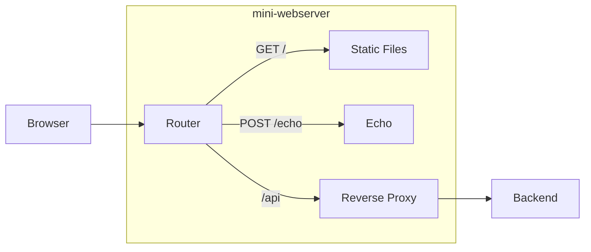
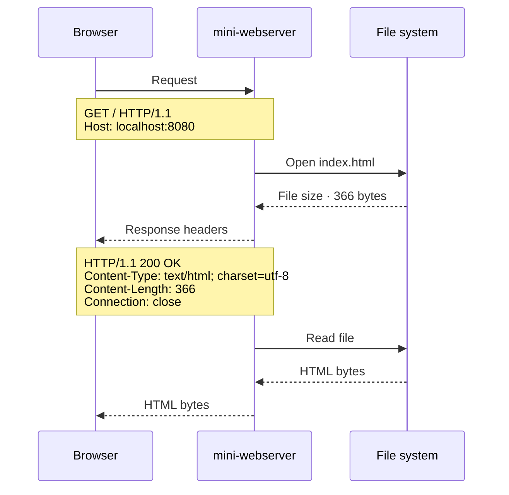
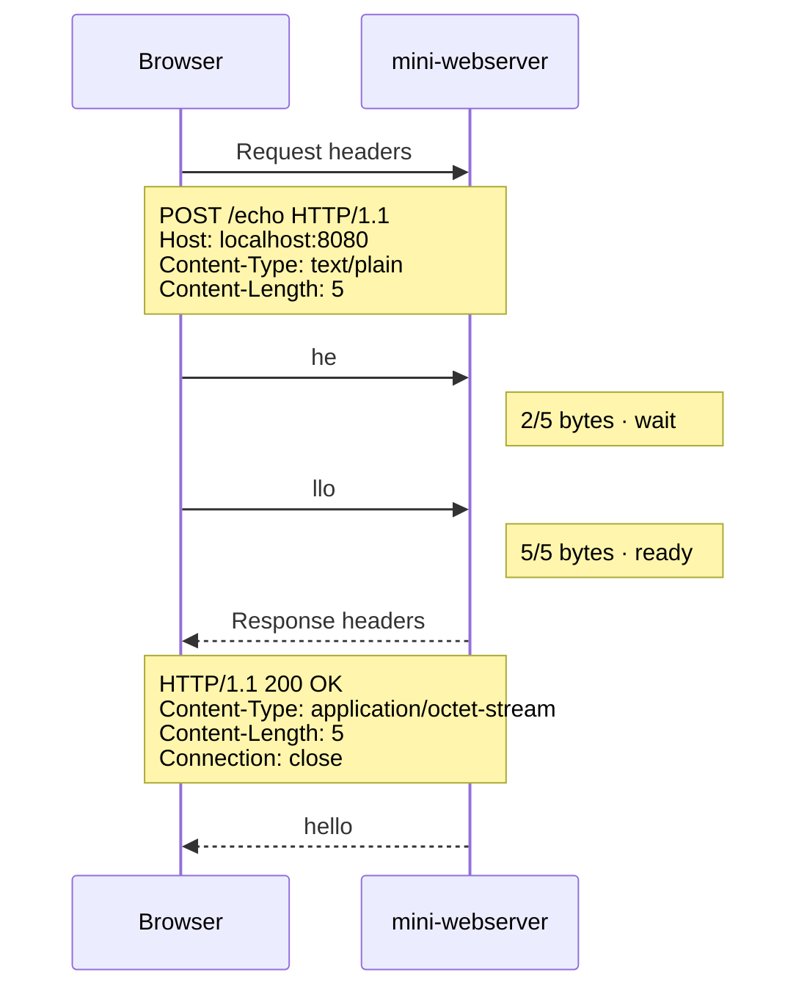
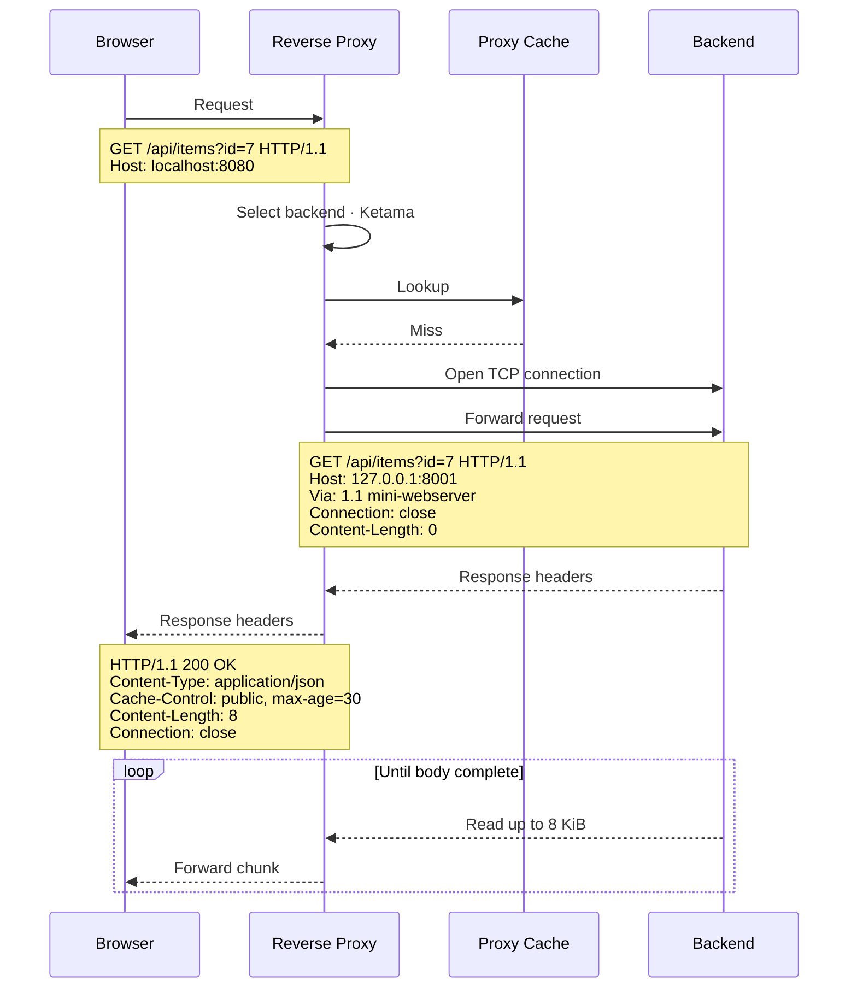
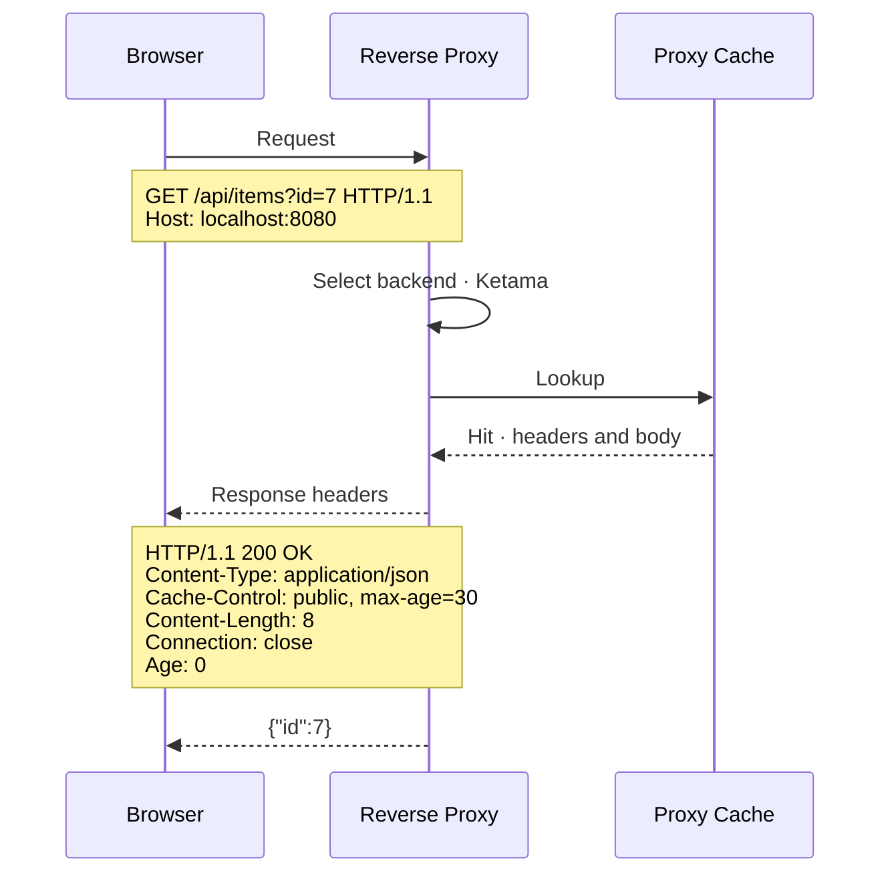
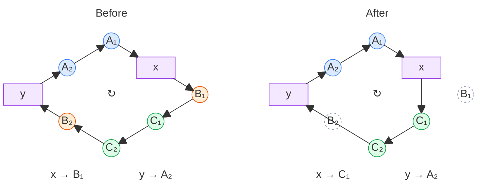
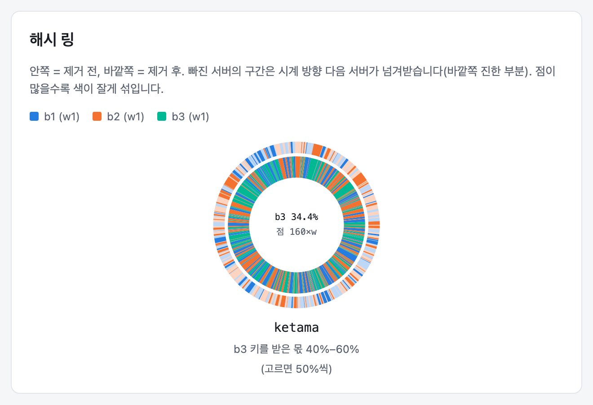
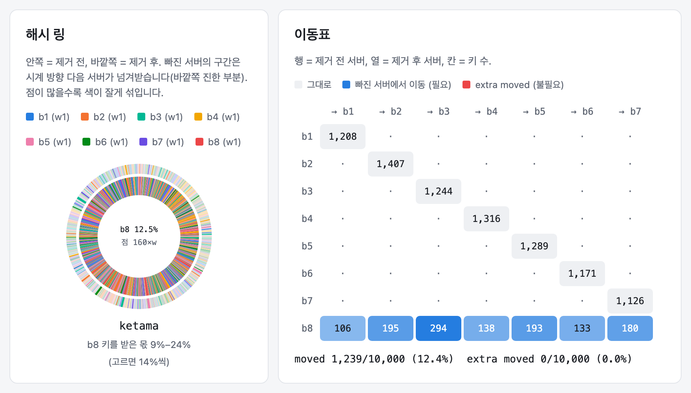
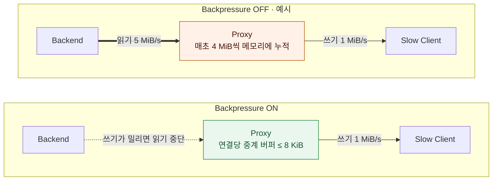
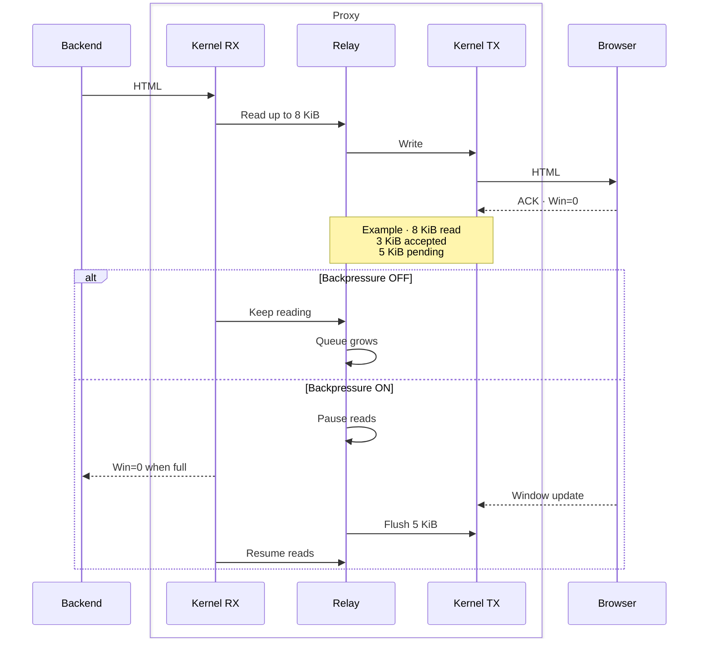

# mini-webserver

## 개요

노트북 환경에서 C10K 문제에 대응하는 것을 목표로 설계한 웹 서버와 리버스 프록시입니다.

## Architecture

### Requests

#### Static · `GET /`

#### Echo · `POST /echo`

#### Proxy · `/api` (Cache Miss)

#### Proxy · `/api` (Cache Hit)

### Concurrency

| 모델 | 처리 단위 | 백엔드 지연 시 |
|---|---|---|
| **Thread Pool** · 기본 | 워커 4개, 워커당 연결 1개 | 워커 4개 점유 시 다음 연결은 큐 대기 |
| **Fork** | 연결당 자식 프로세스 1개 | 해당 자식만 대기 |
| **Event Loop** | 스레드 1개, 연결 여러 개 | 다른 연결 처리 후 응답 도착 시 재개 |

## Features

해당 프로젝트는 리버스 프록시를 통해 다양한 상황에서 서버가 감당하는 부하를 줄이는 것을 핵심 목표로 삼았습니다.

| 상황 | 설계 | 목표 |
|---|---|---|
| 반복 조회 · 특정 IP의 요청 집중 | 응답 캐시 · IP별 요청 제한 | 백엔드에 도달하는 요청 수 감소 |
| 백엔드 추가·제거 | Ketama 일관 해싱 | 담당 백엔드가 바뀌는 클라이언트 IP 수 최소화 |
| 클라이언트와 백엔드의 전송 속도 차이 | 양방향 백프레셔 | 프록시의 본문 중계 버퍼를 연결당 8 KiB로 제한 |

### 1. 응답 캐시와 IP별 요청 제한

- **요청 제한** — 프록시 요청마다 IP별 토큰 1개 사용. 설정한 속도로 보충하며, 소진 시 백엔드 연결 전에 `429 Too Many Requests`와 `Retry-After: 1` 반환
- **캐시 조회** — 토큰 검사 후 GET 요청의 백엔드·`Host`·경로·쿼리로 조회. 적중하면 저장된 헤더와 본문으로 응답
- **저장 대상** — `Cache-Control: public, max-age=…`인 `200 OK` 응답. 인증·쿠키 요청과 `private`·`no-store`·`Vary` 응답은 제외
- **저장 한도** — 최대 64개 항목. 항목당 헤더 2 KiB, 본문 8 KiB, 유효기간 최대 60초
- **공유 범위** — 워커 스레드와 `fork` 자식 프로세스가 캐시·토큰 버킷 공유

### 2. Ketama 일관 해싱을 이용한 로드 밸런싱

- **링 구성** — 경로별 해시 링에 백엔드당 가상 노드 160개 배치. `IP:포트-복제번호`의 MD5 해시로 위치 결정
- **백엔드 선택** — 클라이언트 IP를 해시한 뒤 해당 값 이상의 첫 노드를 이진 탐색. 링 끝을 넘으면 첫 노드 선택
- **서버 증설** — 새 백엔드가 맡는 구간의 IP만 재배정. 나머지 IP는 기존 백엔드 유지
- **공인 IP 공유** — 같은 공인 IP의 요청은 한 백엔드에 집중. IP별 토큰 버킷으로 유입량 제한 가능

#### Hash Ring · Server B Removed

**Client IP → MD5 → Ring position (`x` or `y`) → First server clockwise**

- **서버 제거** — B가 맡던 IP만 재배정. `x`는 B₁에서 C₁로 이동하고, `y`는 A₂ 유지. 그림에서는 가상 노드를 서버당 2개만 표시
- **현재 구현** — 장애 시 연결 오류 응답. 재배치는 설정에서 B를 빼고 프록시를 다시 시작할 때 적용

### 3. Backpressure

- **Download** — Slow browser → pause backend reads
- **Upload** — Slow backend → pause browser reads

## 지원 범위

| 항목 | 구현 범위 |
|---|---|
| HTTP | HTTP/1.0·1.1의 `GET`, `POST`. 연결당 요청 1건을 처리하고 `Connection: close`로 응답합니다. |
| 프록시 라우팅 | 경로별로 IPv4 백엔드를 최대 8개 지정할 수 있습니다. |
| 크기와 시간 제한 | 요청 라인·헤더 합계 16 KiB, 요청 대상 4,096바이트, 요청 본문 1 MiB. 백엔드 연결 거부에는 `502`, 응답 헤더 대기 시간(5초) 초과에는 `504`를 반환합니다. |
| 동시 연결과 종료 | 기본 스레드 풀은 워커 4개와 대기 큐 64칸을 사용합니다. 연결별 프로세스와 이벤트 루프 모드는 각각 최대 64개 연결을 처리합니다. `SIGINT`·`SIGTERM` 수신 시 새 연결 수락을 중단합니다. |

## Tests

통합본에서 확인할 테스트 조건과 기대 결과입니다.

| 구분 | 테스트 | 검증 조건 | 기대 결과 |
|---|---|---|---|
| HTTP | 요청 파싱 | 정상 GET·POST와 여러 번에 나뉘어 도착하는 헤더·본문 | 헤더가 완성될 때까지 기다린 뒤 메서드·경로·본문 파싱 |
| HTTP | 잘못된 요청 | 잘못된 요청 줄·헤더, HTTP/1.1의 `Host` 오류, 미지원 버전 | 형식·`Host` 오류는 `400`, 미지원 버전은 `505` |
| HTTP | 길이 경계 | URI·헤더·본문을 각각 한도와 한도 +1바이트로 전송 | 한도까지 처리, 초과 시 각각 `414`·`431`·`413` |
| HTTP | 본문 길이 검증 | 값이 다른 `Content-Length`를 중복 전송하거나 본문 완료 전에 송신 방향을 닫음 | `400` 반환, 미완성 요청 정리 |
| HTTP | 미지원 요청 | 처리하지 않는 메서드 또는 전송 인코딩으로 요청 | 오류 응답, 요청 본문은 upstream으로 전달되지 않음 |
| HTTP | 정적 파일 | HTML·CSS·이미지 및 없는 파일 요청 | 올바른 MIME 타입과 파일 길이, 누락 파일은 `404` |
| HTTP | 경로 검증 | 잘못된 퍼센트 인코딩, 정적 루트 밖을 가리키는 경로·심볼릭 링크 | 정적 루트 밖의 파일 접근 차단, 잘못된 인코딩은 오류 응답 |
| HTTP | 동적 응답 | POST 에코, 시간 API, CGI 쿼리·표준 입력 | 에코 바이트 일치, 시간 JSON 반환, CGI에 쿼리·본문 전달 |
| HTTP | 응답 헤더 | 정상·오류 응답과 HEAD 요청 | 상태 줄과 `Content-Length` 확인, `405`에 `Allow`, HEAD 본문 0바이트 |
| HTTP | 연결 재사용 | HTTP/1.0·1.1의 `Connection` 설정과 한 소켓의 파이프라인 요청 2건 | 연결 유지·종료 규칙 적용, 파이프라인 응답 2건 순서대로 반환 |
| HTTP | 느린 연결·종료 | 분할 POST, 느린 다운로드, 무응답 연결, 시그널 종료 | 다른 연결 처리, 무응답 연결 만료, 종료 시 열린 연결 정리 |
| Proxy | 라우팅 | 겹치는 경로 규칙, 비슷한 경로명, 잘못된 호스트·포트 | 가장 긴 경로 접두사와 경로 경계 적용, 잘못된 설정 거부 |
| Proxy | 요청 전달 | 쿼리·POST 본문과 연결 전용 헤더가 있는 요청 | 메서드·경로·쿼리·본문 유지, hop-by-hop 헤더 제거, 전달 헤더 확인 |
| Proxy | 응답·오류 | 백엔드 정상 응답, 중간 `1xx`, 연결 거부, 응답 시간 초과 | 최종 응답 중계, 연결 거부는 `502`, 시간 초과는 `504` |
| Proxy | Forward Proxy | 전체 URI로 원 서버 지정, 연결 불가한 원 서버 지정 | 대상 호스트·포트·경로로 요청 전달, 연결 거부는 `502` |
| Cache | Hit·Miss | 같은 공개 GET 반복, 쿼리만 바꿔 GET | 동일 요청은 첫 호출만 백엔드에 도달, 다른 쿼리는 별도 캐시 항목 |
| Cache | 제외·만료 | 인증·쿠키·Range 요청, `private`·`no-store`·`Vary` 응답, 크기 초과·중간 종료·TTL 만료 | 재사용 조건을 충족하지 못한 응답은 캐시에서 제공되지 않음 |
| Cache | 교체·무효화 | 캐시 용량 초과, 성공한 POST 뒤 같은 GET | 설정한 교체 정책으로 퇴출, 변경된 리소스의 새 응답 수신 |
| Cache | ETag | 동일·상이·약한 ETag, 목록·와일드카드로 조건부 GET | 일치 시 본문 없는 `304`, 불일치 시 `200`과 본문 |
| Cache | 요청 제한 | 한 클라이언트에 토큰 2개로 요청 5건 동시 전송, 다른 키로 추가 요청 | `200` 2건, `429` 3건과 `Retry-After`, 토큰 보충 후 성공, 키별 한도 독립 |
| Load Balancing | Round-Robin | 동일 가중치·서로 다른 가중치로 요청 분산 | 동일 가중치는 교대 배정, 가중치가 높으면 더 많은 요청 배정 |
| Load Balancing | Ketama | IP 1,024개로 서버 추가, IP 10,000개로 서버 제거·가중치 조정 | 추가·제거된 서버의 구간만 재배정, 백엔드 목록 순서에 독립, 가중치에 맞춰 분산 |
| Load Balancing | 장애·복구 | 백엔드 연결 실패 또는 헬스 체크 실패·성공 반복 | 살아 있는 후보로 우회, 실패·복구 기준에 따라 DOWN·UP 전환 |
| Load Balancing | 백엔드 포화 | 한 서버가 동시 요청 한도에 도달한 뒤 모든 서버를 포화시킴 | 여유 백엔드로 우회, 전부 포화 시 `503`과 `Retry-After`, 로컬 정적 요청은 `200` |
| Load Balancing | 대기 큐 | 큐 포화, 큐에서 허용 대기 시간 초과 | 각 경우 `503`과 `Retry-After`, 해당 카운터 증가 |
| Load Balancing | 상태 출력 | 연결 한도에 도달하거나 한도를 끄고 `/_lb/status` 조회 | UP·FULL 및 카운터 표시, 열 정렬 유지, 로컬 요청에만 응답 |
| Backpressure | 양방향 중계 | 업로드·다운로드 각각 512 KiB를 수신 중단 후 재개 | 양방향 모두 원본과 바이트 단위 일치 |
| Backpressure | 스트리밍 업로드 | 1 MiB 본문 중 첫 3바이트만 전송해 대기하거나 중간 종료 | 첫 조각부터 백엔드에 전달, 중간 종료 시 백엔드 연결 정리 |
| Backpressure | 응답·연결 한도 | 6 MiB 다운로드, 응답 크기·동시 중계 한도 초과 | 스트리밍 응답 해시 일치, 응답 크기 초과는 `502`, 연결 한도 초과는 `503`, 완료 후 슬롯 회수 |
| Backpressure | 느린 TLS 다운로드 | 느린 다운로드 20건 동시 수신 | 전송 완료, 최대 RSS 40 MiB 미만, 연결별 중계 바이트 집계 |
| Concurrency | 부하·연결 격리 | 백엔드 요청 4건 대기, TLS 연결 40개, 정적 파일 2,000건·동시 50 | 워커 포화와 이벤트 루프의 처리 순서 확인, TLS·정적 파일 요청 실패 0건 |
| TLS | ClientHello·JA4 | 정상·분할·손상 ClientHello, 여러 TLS 버전·SNI·ALPN | 입력 유형 구분, GREASE 제외 및 정렬 규칙에 따른 참조 지문 일치 |
| TLS | 연결 정책 | IPv4·IPv6 CIDR, JA4 라벨, 차단 목록과 만료 | 목록 규칙에 따른 연결 판단, 잘못된 설정 시작 시 거부 |
| TLS | 요청 정책 | 요청 시간창, 반복 오류, 차단 정책, 함정 경로 | 요청·응답 카운터 분리·만료, 정책에 따른 지연·거부 |
| TLS | Proof of Work | 챌린지 누락·오류·유효 응답, 만료 nonce | 오류·누락 시 `401`, 유효 응답은 `200`, nonce의 유효 시간·클라이언트 범위 검사 |
| TLS | Bot Auth | 유효·변조·만료 서명, 알 수 없는 키와 미인증 요청 | 인증 여부와 정책에 따라 `200`·`402`·`403` |
| TLS | 이벤트 루프·타이머 | 타이머 만료·재등록·제거, 느린 연결, 대형 POST, 중복 바인드 | 타이머 순서 유지, 다른 TLS 요청 처리, POST 전달, 중복 바인드 거부 및 종료 시 정리 |
